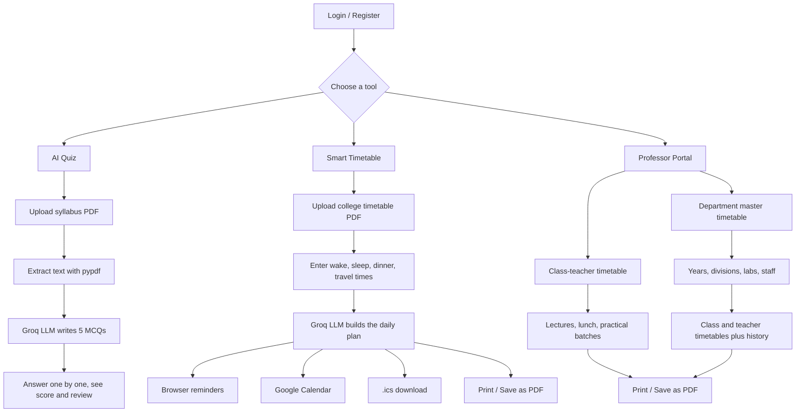
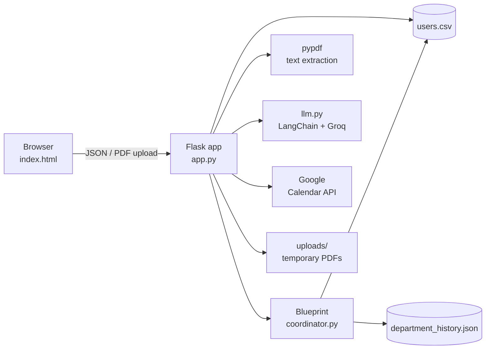

<div align="center">

# 🎓 Smart Timetable AI

### Turn your PDFs into quizzes and a personalised daily study plan

An AI-powered study planner built with **Flask**, **PDF text extraction** and the **Groq LLM**, plus a **professor portal** that generates class and department timetables.

[](https://smart-time-table-4gqu.onrender.com)


[Live Demo](https://smart-time-table-4gqu.onrender.com) · [Features](#-features) · [Screenshots](#-screenshots) · [Setup](#-setup-instructions) · [Deployment](#%EF%B8%8F-deployment-on-render) · [API](#-api-endpoints)

</div>

> ⏳ **Note:** the demo runs on a free server that sleeps when idle, so the first load can take **30–60 seconds**.

---

## 📑 Table of Contents

- [About the Project](#-about-the-project)
- [Features](#-features)
- [Screenshots](#-screenshots)
- [How It Works](#-how-it-works)
- [Architecture](#%EF%B8%8F-architecture)
- [Tech Stack](#%EF%B8%8F-tech-stack)
- [Project Structure](#-project-structure)
- [Setup Instructions](#-setup-instructions)
- [Environment Variables](#%EF%B8%8F-environment-variables)
- [Deployment on Render](#%EF%B8%8F-deployment-on-render)
- [Usage Guide](#-usage-guide)
- [Professor Module](#-professor-module)
- [API Endpoints](#-api-endpoints)
- [Security Notes](#-security-notes)
- [Known Limitations](#%EF%B8%8F-known-limitations)
- [Roadmap](#%EF%B8%8F-roadmap)
- [Contributors](#-contributors)

---

## 📌 About the Project

Students often struggle to balance study time with lectures, travelling, meals and sleep. Building a realistic timetable by hand is slow, and revision material takes time to prepare.

**Smart Timetable AI** reads a student's PDFs, combines them with their daily routine, and uses an LLM to:

- generate **multiple-choice quizzes** from syllabus notes, and
- build a **conflict-free daily timetable** around fixed college classes, travel, meals and sleep,

then helps the student stick to it with **reminders**, **calendar export** and a **print-ready page**.

Professors get a separate portal that builds a **class timetable** (lectures, lunch and practical batches) and a **department master timetable** covering several years, divisions, labs and staff.

## ✨ Features

| | Feature | Description |
|---|---|---|
| 🔐 | **Student accounts** | Register and log in as a student; the login is kept after a page refresh |
| 🏠 | **Student dashboard** | Greeting, live clock and date, rotating study tips and a short how-it-works guide |
| 🧠 | **AI Quiz** | Upload a syllabus or notes PDF (click or drag and drop) and get a 5-question multiple-choice quiz |
| 🎯 | **Quiz runner** | One question at a time with a progress bar, numbered question buttons, keyboard shortcuts (`1`–`4`, `←` `→`), a score ring and a full answer review |
| 🗓️ | **Smart Timetable** | Upload a college timetable PDF, add wake-up, sleep, dinner and travel times, and get a daily plan with study priorities and productivity tips |
| 🔔 | **Reminders** | Browser notifications for wake-up, study, meals and sleep |
| 📆 | **Google Calendar** | Add the whole plan to your calendar with pop-up reminders and optional daily repeats |
| 📥 | **.ics export** | Download a calendar file that works with any calendar app, no Google setup needed |
| 🖨️ | **Print / Save as PDF** | Prints only the timetable on a clean A4 landscape page, without the menus and forms |
| 👩‍🏫 | **Professor accounts** | Separate professor login and session |
| 🧑‍🏫 | **Class-teacher timetable** | Generates lectures, a lunch break and rotating practical batches from college hours, slot lengths, working days, batches and subject credits |
| 🏛️ | **Department master timetable** | Multi-year timetable with divisions, practical batches, labs, staff allocation, per-teacher timetables and a saved history (username needs `@`) |
| 🛡️ | **Protected files** | Only CSS, JS, images and fonts are served, so source code stays private |

## 📸 Screenshots

> Save your screenshots in `docs/screenshots/` using the file names below, and they will show up here.

| Student | |
|---|---|
| **Login** | **Dashboard** |
|  |  |
| **Quiz runner** | **Answer review** |
|  |  |
| **Smart timetable** | **Print view** |
|  |  |

| Professor | |
|---|---|
| **Professor portal** | **Class timetable** |
|  |  |
| **Department master timetable** | |
|  | |

## 🔄 How It Works



## 🏗️ Architecture

The app is a single Flask service. The browser talks to it with JSON and file uploads, and the service calls the Groq LLM and Google Calendar when needed.



| Layer | Where | What it does |
|---|---|---|
| **Presentation** | `index.html` | One page with the student app and the professor portal. Switches views in JavaScript and calls the API with `fetch` |
| **API and sessions** | `app.py` | Student login, session cookies, route protection, PDF upload handling, quiz and timetable generation, Google Calendar and `.ics` export |
| **Professor services** | `coordinator.py` | Professor login, class-teacher timetable builder, department master timetable builder, shared user store and password hashing |
| **AI** | `llm.py` | Creates the Groq model that `app.py` calls through LangChain prompts |
| **Storage** | `users.csv`, `department_history.json`, `uploads/` | Plain files: accounts (hashed passwords), saved department timetables, and PDFs that are deleted after processing |

**Example request: generating a quiz**

1. The student picks a PDF and the page sends it to `POST /api/quiz`.
2. `app.py` checks the student session, saves the PDF under a unique name and reads its text with pypdf.
3. The first part of the text goes to the Groq model through a LangChain prompt that asks for 5 questions as JSON.
4. The JSON is cleaned and returned, the uploaded PDF is deleted, and the page shows the questions one by one.

## 🛠️ Tech Stack

| Layer | Technology |
|---|---|
| **Backend** | Python, Flask (Blueprints), Gunicorn |
| **Frontend** | HTML, CSS, JavaScript (`index.html`) |
| **AI** | Groq API through LangChain (`openai/gpt-oss-20b` by default) |
| **PDF processing** | pypdf |
| **Passwords** | Werkzeug salted password hashes |
| **Calendar** | Google Calendar API, iCalendar (`.ics`) |
| **Config** | python-dotenv |
| **Hosting** | Render |
| **Version control** | Git and GitHub |

## 📂 Project Structure

```
Smart_Time_Table/
├── app.py                   # Flask app: student login, PDF handling, quiz, timetable, calendar
├── coordinator.py           # Blueprint: professor login, class-teacher and department timetables,
│                            #            plus the shared user store (users.csv) and password hashing
├── llm.py                   # Groq LLM setup and configuration
├── index.html               # Web interface (student app and professor portal)
├── requirements.txt         # Python dependencies
├── users.csv                # User accounts (created automatically, not in Git)
├── department_history.json  # Saved department timetables (created automatically, not in Git)
├── uploads/                 # Temporary PDF uploads (created automatically, not in Git)
├── docs/screenshots/        # Screenshots shown in this README
├── credentials.json         # Google OAuth client (optional, not in Git)
├── .env                     # Local secrets (not in Git)
├── .gitignore
└── README.md
```

How the code is split:

- **Student login** (`/api/register`, `/api/login`, `/api/logout`, `/api/me`) is in `app.py`.
- **Professor login** (`/api/professor/register`, `/api/professor/login`, `/api/professor/logout`) is in `coordinator.py`.
- The user store, password hashing and login checks live in `coordinator.py`, and `app.py` imports them for the student login.
- `coordinator.py` is a Blueprint, registered in `app.py` with `app.register_blueprint(coordinator_bp)`.

## 🚀 Setup Instructions

**Prerequisites**

- Python 3.10 or newer (3.12 recommended)
- Git
- A free [Groq API key](https://console.groq.com)
- Optional: a Google Cloud OAuth `credentials.json` for the Google Calendar feature

**1. Clone the repository**

```bash
git clone https://github.com/sakshidange06/Smart_Time_Table.git
cd Smart_Time_Table
```

**2. Create and activate a virtual environment**

```bash
python -m venv venv
venv\Scripts\activate          # Windows (PowerShell or Command Prompt)
# source venv/bin/activate     # macOS / Linux
```

**3. Install the dependencies**

```bash
pip install -r requirements.txt
```

**4. Create a `.env` file** in the project root. Use no spaces or quotes around the values (see [Environment Variables](#%EF%B8%8F-environment-variables) for all options):

```env
GROQ_API_KEY=your_groq_api_key
FLASK_SECRET_KEY=any_long_random_text
```

**5. Optional: enable Google Calendar.** Put your `credentials.json` in the project root and add `http://127.0.0.1:5000/oauth2callback` as an authorized redirect URI in your OAuth client.

**6. Run the app**

```bash
python app.py
```

Open **http://127.0.0.1:5000** in your browser.

**7. Log in**

- **Student:** register a new account, or use the default `admin` account (password from `ADMIN_PASSWORD`, default `password123`).
- **Professor:** click **Professor Portal** on the login page and register. Add `@` to the username (for example `name@dept`) to unlock the department timetable.

`users.csv`, `department_history.json` and the `uploads/` folder are created automatically on first use.

**Troubleshooting**

| Problem | Fix |
|---|---|
| `ModuleNotFoundError` | Activate the virtual environment, then run `pip install -r requirements.txt` again |
| The quiz or plan fails with an API error | Check `GROQ_API_KEY` in `.env` and restart the app |
| "No text could be extracted from this PDF" | The PDF is scanned or image-only. Use a text-based PDF |
| "Cannot write users.csv" | Close `users.csv` if it is open in Excel |
| Google sign-in fails | Check `credentials.json` and the redirect URI |

## ⚙️ Environment Variables

Set these in a `.env` file for local use, or in the **Environment** tab on Render.

```env
# Required
GROQ_API_KEY=your_groq_api_key
FLASK_SECRET_KEY=any_long_random_text

# Optional
GROQ_MODEL=openai/gpt-oss-20b
GROQ_TIMEOUT=60
GROQ_MAX_RETRIES=1
ADMIN_PASSWORD=choose_a_strong_password
```

| Variable | Required | Default | Purpose |
|---|:---:|---|---|
| `GROQ_API_KEY` | ✅ | n/a | Groq API key for the quiz and timetable |
| `FLASK_SECRET_KEY` | ✅ | n/a | Signs login sessions; use a long random string |
| `GROQ_MODEL` | | `openai/gpt-oss-20b` | LLM model name |
| `GROQ_TIMEOUT` | | `60` | Seconds to wait for a model reply |
| `GROQ_MAX_RETRIES` | | `1` | Retries on connection errors |
| `ADMIN_PASSWORD` | | `password123` | Password of the default `admin` account, used when `users.csv` is first created |
| `PYTHON_VERSION` | | Render default | Set to `3.12.8` on Render |

Render also sets a `RENDER` variable automatically. The app uses it to turn on secure cookies and to skip the local-only OAuth setting. Never commit your `.env` file.

## ☁️ Deployment on Render

> GitHub Pages cannot run this app because it needs a Python backend. Use Render (or a similar host).

1. Push the project to GitHub.
2. On [render.com](https://render.com), choose **New → Web Service** and select this repository.
3. Set the commands:

   | Setting | Value |
   |---|---|
   | **Build Command** | `pip install -r requirements.txt` |
   | **Start Command** | `gunicorn app:app --workers 1 --threads 4 --timeout 200` |

4. Add the variables from the [Environment Variables](#%EF%B8%8F-environment-variables) table in the **Environment** tab (at least `GROQ_API_KEY` and `FLASK_SECRET_KEY`).
5. Click **Create Web Service**. Render redeploys automatically on every push to `main`.

<details>
<summary><b>Optional: enable Google Calendar on Render</b></summary>

1. Create an OAuth client in Google Cloud Console and download `credentials.json`.
2. In Render, open **Environment → Secret Files** and upload it as `credentials.json`.
3. Add `https://YOUR-APP.onrender.com/oauth2callback` to the OAuth client's **Authorized redirect URIs**.

</details>

## 📖 Usage Guide

**🧠 AI Quiz**
1. Register or log in as a student.
2. Open the **Quiz** tab and choose a syllabus or notes PDF (click the box or drag and drop).
3. Answer one question at a time. Use the number buttons or keyboard shortcuts to move around.
4. Press **Submit Answers** to see your score and a full review of right and wrong answers.

**🗓️ Smart Timetable**
1. Open the **Timetable** tab and upload your college timetable PDF.
2. Enter your wake-up, sleep and dinner times, plus any travel timings.
3. Generate the plan, then enable reminders, add it to Google Calendar, download the `.ics` file, or print it.

**👩‍🏫 Professor**
1. Use the **Professor Portal** button on the login page to register or log in.
2. Choose **class teacher** or **department** timetable (see below).
3. Use **Print / Save as PDF** to get a clean copy of any generated timetable.

## 🎓 Professor Module

All professor logic lives in `coordinator.py`. Every professor endpoint needs an active professor session (otherwise `401`).

### Class-teacher timetable

`POST /api/professor/class-teacher/submit`

```json
{
  "college_start": "10:15",
  "college_end": "16:45",
  "lecture_minutes": 60,
  "practical_minutes": 120,
  "batch_count": 3,
  "batches": ["B1", "B2", "B3"],
  "working_days": ["MON", "TUE", "WED", "THU", "FRI", "SAT"],
  "subjects": [
    { "name": "OSY", "credits": 4 },
    { "name": "DBMS", "credits": 3 }
  ]
}
```

The server checks the inputs (valid `HH:MM` times, end after start, positive numbers, `batch_count` equal to the number of batches, every subject with a name and positive credits). It replies with `status: "generated"`, a `rows` list and a Markdown `timetable`.

How the timetable is built:
- Subjects with more credits get lectures first.
- A 30-minute lunch break is added at 12:15.
- Each day has one practical slot, and the batches rotate through the practicals.

### Department master timetable

Needs a professor username that contains **`@`** (for example `name@dept`). Otherwise the API returns `403`.

- `POST /api/professor/department/generate` takes years (capacity and divisions), subjects and practicals per year, labs and staff allocation. It returns practical batches, a class timetable for each year, a timetable for each teacher and a record ID.
- `GET /api/professor/department/history` lists all earlier timetables, newest first, so they can be viewed or printed again.

History is kept in memory and mirrored to `department_history.json`.

## 🔌 API Endpoints

<details>
<summary><b>Click to expand</b></summary>

| Method | Endpoint | Description |
|---|---|---|
| `GET` | `/` | Web interface |
| `GET` | `/api/me` | Who is logged in (restores the login after a refresh) |
| `POST` | `/api/register` | Register a student *(app.py)* |
| `POST` | `/api/login` | Student login *(app.py)* |
| `POST` | `/api/logout` | Student logout *(app.py)* |
| `POST` | `/api/professor/register` | Register a professor *(coordinator.py)* |
| `POST` | `/api/professor/login` | Professor login *(coordinator.py)* |
| `POST` | `/api/professor/logout` | Professor logout *(coordinator.py)* |
| `POST` | `/api/professor/class-teacher/submit` | Generate a class-teacher timetable *(coordinator.py)* |
| `POST` | `/api/professor/department/generate` | Generate a department master timetable, needs `@` in username *(coordinator.py)* |
| `GET` | `/api/professor/department/history` | List saved department timetables, needs `@` in username *(coordinator.py)* |
| `POST` | `/api/quiz` | Generate a quiz from a PDF (student login required) |
| `POST` | `/api/timetable` | Generate a daily timetable from a PDF and routine (student login required) |
| `POST` | `/api/timetable/events` | Parse a timetable into timed events for notifications (student login required) |
| `POST` | `/api/calendar/add` | Add the timetable to Google Calendar (student login required) |
| `POST` | `/api/calendar/ics` | Download the timetable as an `.ics` file (student login required) |
| `GET` | `/google/login` | Start the Google sign-in flow |
| `GET` | `/api/google/status` | Check the Google connection |
| `POST` | `/api/google/disconnect` | Disconnect Google |

</details>

## 🔒 Security Notes

- **Never commit** `.env`, `credentials.json`, `users.csv`, `department_history.json` or `uploads/`. Add them to `.gitignore`.
- If an API key is ever exposed, revoke it in the Groq console and create a new one.
- Passwords are saved as salted hashes. Old plain-text accounts in `users.csv` still log in once and are upgraded automatically.
- Only whitelisted asset types (CSS, JS, images, fonts) can be downloaded from the server.
- Session cookies are `HttpOnly`, `SameSite=Lax`, and `Secure` when deployed on Render.
- Only PDF uploads are accepted (up to 20 MB), and they are deleted right after processing.
- Quiz, timetable and calendar endpoints return `401` unless a student is logged in. Professor endpoints return `401` unless a professor is logged in.
- Only one role (student or professor) is logged in per browser at a time.

## ⚠️ Known Limitations

- Accounts are stored in `users.csv`, not in a database.
- On the free hosting plan the disk resets on every restart, so accounts and department history on the live site are temporary.
- The department timetable does not yet detect teacher clashes between years.
- Class-teacher timetables are shown on screen only and are not saved.
- Browser reminders only fire while the tab is open.
- Google Calendar needs your own `credentials.json`.
- Results depend on PDF text quality. Scanned, image-only PDFs cannot be read.

## 🗺️ Roadmap

**Completed**

- [x] Student login and registration with hashed passwords and sessions
- [x] AI quiz from a syllabus PDF with a question-by-question runner and answer review
- [x] Smart daily timetable with browser reminders
- [x] Google Calendar and `.ics` export
- [x] Print-ready timetables (timetable only, A4 landscape)
- [x] Professor login and class-teacher timetable generation
- [x] Department master timetable with saved history
- [x] Student dashboard with study tips

**Planned improvements** (not built yet)

- Database storage for accounts and history
- Teacher and lab clash detection for department timetables
- Deadline tracking and conflict detection
- Saved timetable and quiz history for students

## 👥 Contributors

<table>
  <tr>
    <td align="center"><a href="https://github.com/sakshidange06"><b>@sakshidange06</b></a></td>
    <td align="center"><a href="https://github.com/shraddhadange31-png"><b>@shraddhadange31-png</b></a></td>
    <td align="center"><a href="https://github.com/SejalGawali"><b>@SejalGawali</b></a></td>
  </tr>
</table>

---

<div align="center">

⭐ If you find this project useful, please give it a star!

</div>
