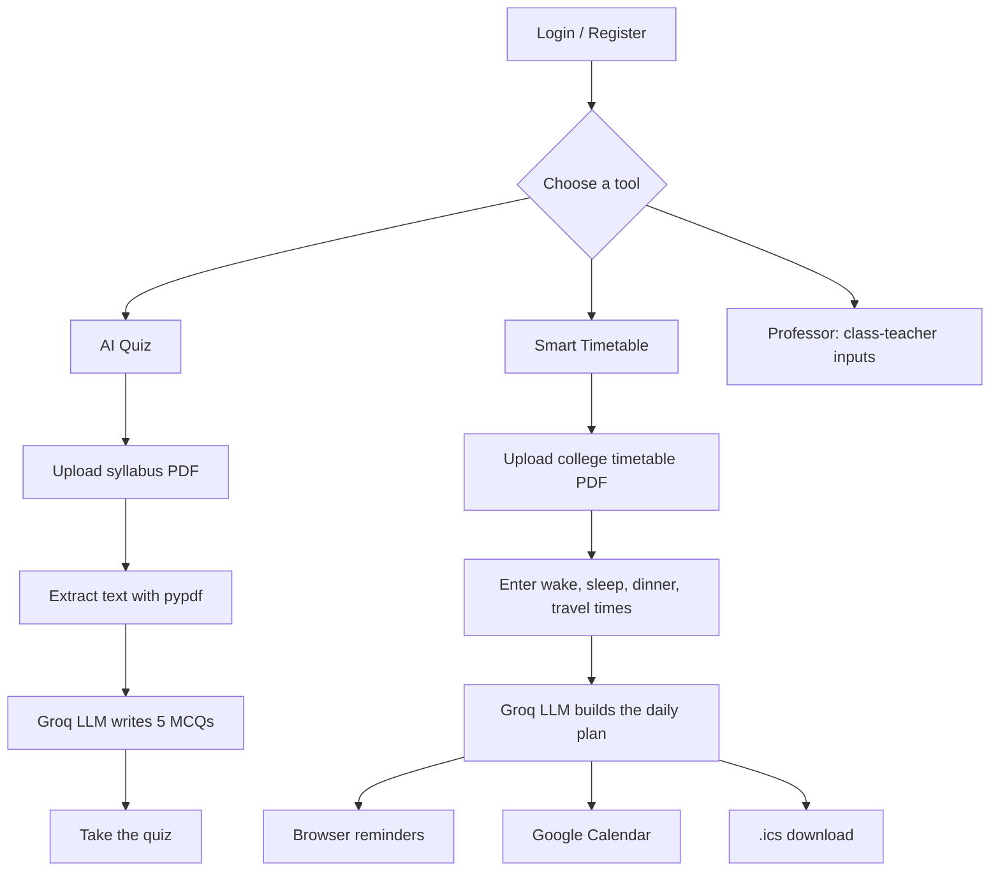

<div align="center">

# 🎓 Smart Timetable AI

### Turn your PDFs into quizzes and a personalised daily study plan

An AI-powered study planner built with **Flask**, **PDF text extraction** and the **Groq LLM**.

[](https://smart-time-table-4gqu.onrender.com)


[Live Demo](https://smart-time-table-4gqu.onrender.com) · [Features](#-features) · [Quick Start](#-quick-start) · [Deployment](#%EF%B8%8F-deployment-on-render) · [API](#-api-endpoints)

</div>

> ⏳ **Note:** the demo runs on a free server that sleeps when idle, so the first load can take **30–60 seconds**.

---

## 📑 Table of Contents

- [About the Project](#-about-the-project)
- [Features](#-features)
- [How It Works](#-how-it-works)
- [Tech Stack](#-tech-stack)
- [Project Structure](#-project-structure)
- [Quick Start](#-quick-start)
- [Configuration](#-configuration)
- [Deployment on Render](#%EF%B8%8F-deployment-on-render)
- [Usage Guide](#-usage-guide)
- [API Endpoints](#-api-endpoints)
- [Security Notes](#-security-notes)
- [Known Limitations](#%EF%B8%8F-known-limitations)
- [Roadmap](#%EF%B8%8F-roadmap)
- [Contributors](#-contributors)

---

## 📌 About the Project

Students often struggle to balance study time with lectures, travelling, meals and sleep. Building a realistic timetable by hand is slow, and revision material takes time to prepare.

**Smart Timetable AI** reads a student's PDFs, combines them with their daily routine, and uses an LLM to:

- generate **multiple-choice quizzes** from syllabus notes, and
- build a **conflict-free daily timetable** around fixed college classes, travel, meals and sleep,

then helps the student stick to it with **reminders** and **calendar export**.

## ✨ Features

| | Feature | Description |
|---|---|---|
| 🔐 | **Student accounts** | Register and log in with a username and password |
| 👩‍🏫 | **Professor accounts** | Separate professor role with a class-teacher input form (working days, batches, subjects, credits) |
| 🧠 | **AI Quiz** | Upload a syllabus or notes PDF and get a 5-question multiple-choice quiz |
| 🗓️ | **Smart Timetable** | Upload a college timetable PDF, add wake-up, sleep, dinner and travel times, and get a daily plan with study priorities and productivity tips |
| 🔔 | **Reminders** | Browser notifications for wake-up, study, meals and sleep |
| 📆 | **Google Calendar** | Add the whole plan to your calendar with pop-up reminders and optional daily repeats |
| 📥 | **.ics export** | Download a calendar file that works with any calendar app, no Google setup needed |
| 🛡️ | **Protected files** | Only CSS, JS, images and fonts are served, so source code stays private |

## 🔄 How It Works



## 🛠️ Tech Stack

| Layer | Technology |
|---|---|
| **Backend** | Python, Flask, Gunicorn |
| **Frontend** | HTML, CSS, JavaScript (`index.html`) |
| **AI** | Groq API through LangChain (`openai/gpt-oss-20b` by default) |
| **PDF processing** | pypdf |
| **Calendar** | Google Calendar API, iCalendar (`.ics`) |
| **Config** | python-dotenv |
| **Hosting** | Render |
| **Version control** | Git and GitHub |

## 📂 Project Structure

```
Smart_Time_Table/
├── app.py              # Flask app: routes, auth, PDF handling, timetable, calendar
├── llm.py              # Groq LLM setup and configuration
├── index.html          # Web interface
├── requirements.txt    # Python dependencies
├── users.csv           # User accounts (created automatically if missing)
├── uploads/            # Uploaded PDFs (created automatically, not in Git)
├── .env                # Local secrets (not in Git)
├── .gitignore
└── README.md
```

## 🚀 Quick Start

**Prerequisites:** Python 3.10+ and a free [Groq API key](https://console.groq.com).

```bash
# 1. Clone the repository
git clone https://github.com/sakshidange06/Smart_Time_Table.git
cd Smart_Time_Table

# 2. Create and activate a virtual environment
python -m venv venv
venv\Scripts\activate          # Windows
# source venv/bin/activate     # macOS / Linux

# 3. Install dependencies
pip install -r requirements.txt
```

**4. Create a `.env` file** in the project root. Use no spaces or quotes around the values:

```env
GROQ_API_KEY=your_groq_api_key
FLASK_SECRET_KEY=any_long_random_text
```

**5. Run the app**

```bash
python app.py
```

Open **http://127.0.0.1:5000** in your browser.

## ⚙️ Configuration

| Variable | Required | Default | Purpose |
|---|:---:|---|---|
| `GROQ_API_KEY` | ✅ | n/a | Groq API key for the quiz and timetable |
| `FLASK_SECRET_KEY` | ✅ | n/a | Signs login sessions; use a long random string |
| `GROQ_MODEL` | | `openai/gpt-oss-20b` | LLM model name |
| `GROQ_TIMEOUT` | | `60` | Seconds to wait for a model reply |
| `GROQ_MAX_RETRIES` | | `1` | Retries on connection errors |
| `ADMIN_PASSWORD` | | `password123` | Password of the default `admin` account |
| `PYTHON_VERSION` | | Render default | Set to `3.12.8` on Render |

## ☁️ Deployment on Render

> GitHub Pages cannot run this app because it needs a Python backend. Use Render (or a similar host).

1. Push the project to GitHub.
2. On [render.com](https://render.com), choose **New → Web Service** and select this repository.
3. Set the commands:

   | Setting | Value |
   |---|---|
   | **Build Command** | `pip install -r requirements.txt` |
   | **Start Command** | `gunicorn app:app --workers 1 --threads 4 --timeout 200` |

4. Add the variables from the [Configuration](#%EF%B8%8F-configuration) table in the **Environment** tab (at least `GROQ_API_KEY` and `FLASK_SECRET_KEY`).
5. Click **Create Web Service**. Render redeploys automatically on every push to `main`.

<details>
<summary><b>Optional: enable Google Calendar on Render</b></summary>

1. Create an OAuth client in Google Cloud Console and download `credentials.json`.
2. In Render, open **Environment → Secret Files** and upload it as `credentials.json`.
3. Add `https://YOUR-APP.onrender.com/oauth2callback` to the OAuth client's **Authorized redirect URIs**.

</details>

## 📖 Usage Guide

**🧠 AI Quiz**
1. Register or log in.
2. Open the quiz section and upload a syllabus or notes PDF.
3. Answer the generated 5-question multiple-choice quiz.

**🗓️ Smart Timetable**
1. Log in and open the timetable section.
2. Upload your college timetable PDF.
3. Enter your wake-up, sleep and dinner times, plus any travel timings.
4. Generate the plan, then enable reminders, add it to Google Calendar, or download the `.ics` file.

**👩‍🏫 Professor**
1. Use the **Professor Only** button on the login page to register or log in.
2. Fill in the class-teacher form (college hours, slot lengths, batches, working days, subjects and credits).

## 🔌 API Endpoints

<details>
<summary><b>Click to expand</b></summary>

| Method | Endpoint | Description |
|---|---|---|
| `GET` | `/` | Web interface |
| `POST` | `/api/register` | Register a student |
| `POST` | `/api/login` | Student login |
| `POST` | `/api/professor/register` | Register a professor |
| `POST` | `/api/professor/login` | Professor login |
| `POST` | `/api/professor/logout` | Professor logout |
| `POST` | `/api/professor/class-teacher/submit` | Submit class-teacher inputs |
| `POST` | `/api/quiz` | Generate a quiz from a PDF |
| `POST` | `/api/timetable` | Generate a daily timetable from a PDF and routine |
| `POST` | `/api/timetable/events` | Parse a timetable into timed events for notifications |
| `POST` | `/api/calendar/add` | Add the timetable to Google Calendar |
| `POST` | `/api/calendar/ics` | Download the timetable as an `.ics` file |
| `GET` | `/google/login` | Start the Google sign-in flow |
| `GET` | `/api/google/status` | Check the Google connection |
| `POST` | `/api/google/disconnect` | Disconnect Google |

</details>

## 🔒 Security Notes

- **Never commit** `.env`, `credentials.json` or real user data. They are listed in `.gitignore`.
- If an API key is ever exposed, revoke it in the Groq console and create a new one.
- Only whitelisted asset types (CSS, JS, images, fonts) can be downloaded from the server.
- Session cookies are `HttpOnly`, `SameSite=Lax`, and `Secure` when deployed on Render.

## ⚠️ Known Limitations

- Accounts are stored in `users.csv` with **plain-text passwords**. Moving to a database with hashed passwords is planned.
- On the free hosting plan the disk resets on every restart, so accounts registered on the live site are temporary.
- Professor class-timetable **generation is not implemented yet**; the form currently validates and receives the inputs.
- Results depend on PDF text quality. Scanned, image-only PDFs cannot be read.

## 🗺️ Roadmap

- [x] Student login and registration
- [x] AI quiz from a syllabus PDF
- [x] Smart daily timetable with reminders
- [x] Google Calendar and `.ics` export
- [x] Professor login and class-teacher input form
- [ ] Database storage with hashed passwords
- [ ] Automatic class timetable generation for professors
- [ ] Deadline tracking and conflict detection
- [ ] Saved timetable and quiz history

## 👥 Contributors

<table>
  <tr>
    <td align="center"><a href="https://github.com/sakshidange06"><b>@sakshidange06</b></a></td>
    <td align="center"><a href="https://github.com/shraddhadange31-png"><b>@shraddhadange31-png</b></a></td>
    <td align="center"><a href="https://github.com/SejalGawali"><b>@SejalGawali</b></a></td>
  </tr>
</table>

---

<div align="center">

⭐ If you find this project useful, please give it a star!

</div>
